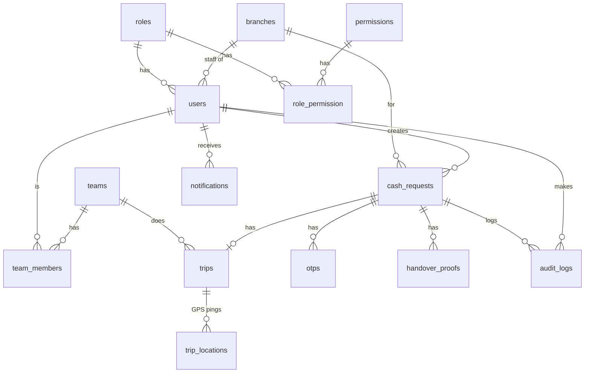

# CashRoute Backend — Team Guide

How the team builds the CashRoute API together: the database design, how to set up MySQL in
XAMPP, how to create tables with Laravel migrations, and which git branch each person works on.

> **Order matters:** one person does **Part 3 (database setup)** on `feature/database-setup` and
> merges it first. After that, everyone else branches from the updated `develop` and builds their
> module in parallel.

---

## Part 1 — Database design

This is your ERD, adjusted so it works with Laravel and matches what the frontend already sends and
expects. **Why** each change was made is listed under the diagram.



### Tables

Laravel conventions: table names are **plural snake_case**, every table has `id` (big integer) and
`created_at` / `updated_at` unless noted.

#### `roles`
| Column | Type | Notes |
| --- | --- | --- |
| id | bigint PK | |
| name | string, unique | `Super Admin`, `Maker`, `Checker`, `Maker + Checker`, `Driver`, `Custodian` |

#### `permissions`
| Column | Type | Notes |
| --- | --- | --- |
| id | bigint PK | |
| code | string, unique | e.g. `requests.create`, `requests.approve`, `branches.manage`, `users.manage`, `teams.manage`, `audit.view`, `reports.view`, `trips.update` |
| name | string | Human label, e.g. "Approve cash requests" |

#### `role_permission` (pivot, no timestamps)
| Column | Type | Notes |
| --- | --- | --- |
| role_id | FK → roles | composite PK |
| permission_id | FK → permissions | composite PK |

#### `users` — **extends Laravel's existing table** (don't create a new one)
Laravel already has: `id`, `name`, `email`, `password`, `remember_token`, timestamps. Add:

| Column | Type | Notes |
| --- | --- | --- |
| username | string, unique | Login name, e.g. `admin.maker` |
| employee_id | string, unique, nullable | e.g. `U-001` |
| phone | string, nullable | |
| role_id | FK → roles | |
| branch_id | FK → branches, nullable | Office staff belong to a branch / HQ |
| is_delivery_member | boolean, default false | Your `member` column (drivers/custodians) |
| is_locked | boolean, default false | |
| failed_attempts | unsigned tinyint, default 0 | Lock at 5 |

#### `branches`
| Column | Type | Notes |
| --- | --- | --- |
| id | bigint PK | |
| code | string, unique | **New** — frontend shows/searches `BR-001` |
| name | string | |
| address | text | |
| lat | decimal(10,7) | |
| lng | decimal(10,7) | Renamed from `long` (reserved word in MySQL) |
| handover_radius | unsigned int | metres |
| contact_name | string, nullable | |
| contact_phone | string, nullable | Your `mobile_number` |
| contact_email | string, nullable | OTP delivery |
| is_hq | boolean, default false | |
| is_active | boolean, default true | Your `status`; "deactivate" sets this to false |

#### `teams`
| Column | Type | Notes |
| --- | --- | --- |
| id | bigint PK | |
| name | string, unique | `Team A` |
| is_available | boolean, default true | false while on a trip |

#### `team_members` (pivot)
| Column | Type | Notes |
| --- | --- | --- |
| team_id | FK → teams | composite PK |
| user_id | FK → users, **unique** | A person is in one team at a time |

#### `cash_requests` — your REQUEST table
Named `cash_requests` because `Request` clashes with Laravel's own `Request` class.

| Column | Type | Notes |
| --- | --- | --- |
| id | bigint PK | |
| reference | string, unique | `REQ-1053` shown in the UI |
| type | enum `deposit`, `withdrawal` | Deposit = branch → HQ, Withdrawal = HQ → branch |
| branch_id | FK → branches | |
| amount | decimal(15,2) | |
| currency | string(3), default `MMK` | |
| requested_date | date | **New** — "Requested date" field |
| complete_within | enum `1h`,`3h`,`5h`,`10h`,`12h`,`1d`,`2d` | **New** — "Complete within" dropdown |
| remarks | text, nullable | |
| status | enum `pending`,`approved`,`rejected`,`assigned`,`in_transit`,`delivered`,`cancelled` | |
| created_by | FK → users | Maker |
| approved_by | FK → users, nullable | Checker |
| approved_at | timestamp, nullable | |
| reason | text, nullable | Reject / cancel reason |
| cancelled_by | FK → users, nullable | |

Removed `duration` (it was a timestamp) — trip duration is `trips.completed_at - trips.started_at`.
The request **timeline** shown in the UI is built from `audit_logs`, so no extra table is needed.

#### `trips`
| Column | Type | Notes |
| --- | --- | --- |
| id | bigint PK | |
| cash_request_id | FK → cash_requests, **unique** | One trip per request |
| team_id | FK → teams | |
| status | enum `assigned`,`in_transit`,`delivered`,`cancelled` | |
| current_lat / current_lng | decimal(10,7), nullable | Latest position |
| last_ping_at | timestamp, nullable | **New** — "Stale GPS" = older than 2 min |
| started_at / completed_at | timestamp, nullable | |

#### `trip_locations` (optional, for the route line on the live map)
| Column | Type | Notes |
| --- | --- | --- |
| id | bigint PK | |
| trip_id | FK → trips | |
| lat / lng | decimal(10,7) | |
| recorded_at | timestamp | No `updated_at` needed |

#### `otps`
| Column | Type | Notes |
| --- | --- | --- |
| id | bigint PK | |
| cash_request_id | FK → cash_requests | |
| stage | enum `pickup`, `dropoff` | |
| code_hash | string | **Store hashed**, never the plain code |
| sent_to | string | Phone/email it was sent to |
| expires_at | timestamp | |
| attempts | unsigned tinyint, default 0 | Limit e.g. 3 |
| status | enum `pending`,`verified`,`expired`,`failed` | |
| verified_at | timestamp, nullable | |

#### `handover_proofs`
| Column | Type | Notes |
| --- | --- | --- |
| id | bigint PK | |
| cash_request_id | FK → cash_requests | |
| stage | enum `pickup`, `dropoff` | |
| confirmed_amount | decimal(15,2) | |
| denominations | json, nullable | e.g. `{"10000": 15, "5000": 20}` |
| photo_path | string | Stored file path, not a full URL |
| signature_path | string, nullable | |
| submitted_by | FK → users | |
| submitted_at | timestamp | |

#### `audit_logs` — your AUDIT_TRAIL
| Column | Type | Notes |
| --- | --- | --- |
| id | bigint PK | |
| user_id | FK → users | Who did it |
| cash_request_id | FK → cash_requests, nullable | Not every action is about a request |
| action | string | `create`, `edit`, `approve`, `reject`, `assign`, `cancel`, `in_transit`, `delivered`, `branch.update`, … |
| details | json, nullable | Reason, old/new values, etc. |
| source | enum `web`, `mobile` | "Web portal" / "Mobile app" |
| lat / lng | decimal(10,7), nullable | GPS stamp for app actions |
| created_at | timestamp | **No `updated_at`** — audit rows are never edited |

#### `notifications`
> If you later use Laravel's built-in notification system (`php artisan make:notifications-table`), it
> creates its own `notifications` table — in that case name this one `user_notifications`.

| Column | Type | Notes |
| --- | --- | --- |
| id | bigint PK | |
| user_id | FK → users | Recipient |
| cash_request_id | FK → cash_requests, nullable | |
| type | string | `request.submitted`, `team.assigned`, `gps.stale`, … |
| title | string | |
| body | text | |
| read_at | timestamp, nullable | Replaces `is_read` (also tells you *when*) |
| created_at | timestamp | |

### What changed from the original diagram, and why

| Original | Change | Why |
| --- | --- | --- |
| `SESSION` table | **Removed** — use Laravel's built-in `sessions` + Sanctum's `personal_access_tokens` | Laravel already creates a table named `sessions`; a second one would clash. Login/logout events go to `audit_logs`. |
| `USER.password` | Keep, but always `Hash::make()` | Never store plain passwords |
| `USER.failed-attempt` | `failed_attempts` | Hyphens aren't allowed in column names |
| `USER.member` | `is_delivery_member` | Clearer name |
| — | `users.name`, `users.email`, `users.branch_id` | The UI shows full names, emails and each user's branch |
| `BRANCH` | Added `code`; `long` → `lng`; `status` → `is_active` | UI uses branch codes; `long` is a MySQL keyword |
| `REQUEST` | Table `cash_requests`; added `reference`, `requested_date`, `complete_within`, `cancelled_by`; dropped `duration` | Matches the New Cash Request form; avoids the `Request` class name clash |
| `TRIP` | Added `last_ping_at`, optional `trip_locations` | Needed for "Stale GPS" and the route on the live map |
| `OTP.otp_code` | `code_hash` + `sent_to` + `verified_at` | OTPs are secrets — store a hash |
| `HANDOVER_PROOF` | Added `stage`, `denominations`; `*_url` → `*_path` | Requirements ask for denomination confirmation; files are stored by Laravel |
| `NOTIFICATION.is_read` | `read_at` | Same info plus the time it was read |
| Role "Maker · Checker" | A role named `Maker + Checker` with both permissions | One `role_id` per user; permissions do the rest |

---

## Part 2 — Set up MySQL in XAMPP (everyone, once)

1. Open the **XAMPP Control Panel** → **Start** both **Apache** and **MySQL**.
2. Open **http://localhost/phpmyadmin** → click **New** (left side).
3. Database name `cashroute`, collation **`utf8mb4_unicode_ci`** → **Create**.
4. In the backend folder, edit **`.env`** (not `.env.example`) — replace the `DB_` lines with:

   ```
   DB_CONNECTION=mysql
   DB_HOST=127.0.0.1
   DB_PORT=3306
   DB_DATABASE=cashroute
   DB_USERNAME=root
   DB_PASSWORD=
   ```

   (XAMPP's MySQL user is `root` with an empty password by default.)

5. Create the tables:

   ```bash
   php artisan migrate
   ```

6. Refresh phpMyAdmin → `cashroute` now lists the tables.

Useful commands:

| Command | What it does |
| --- | --- |
| `php artisan migrate` | Create any tables that don't exist yet (safe to run anytime) |
| `php artisan migrate:status` | Show which migrations have run |
| `php artisan migrate:fresh --seed` | **Deletes all tables**, recreates them and fills demo data — local only |
| `php artisan db:seed` | Fill demo data |
| `php artisan tinker` | PHP console to try queries, e.g. `App\Models\Branch::count()` |

Each teammate has **their own local database**. Only the *migration files* are shared through
git — after pulling, run `php artisan migrate` to get everyone else's new tables.

---

## Part 3 — Create the tables (owner: whoever takes `feature/database-setup`)

Run these in the backend folder. Each `make:model` creates a **model** + **migration** (`-m`), a
**factory** (`-f`) and a **seeder** (`-s`); `-c --api` adds an API controller with
`index/store/show/update/destroy`.

Create them **in this order** so foreign keys point at tables that already exist:

```bash
php artisan make:model Role -mfs
php artisan make:model Permission -mfs
php artisan make:migration create_role_permission_table
php artisan make:model Branch -mfsc --api
php artisan make:migration add_cashroute_fields_to_users_table --table=users
php artisan make:model Team -mfsc --api
php artisan make:migration create_team_members_table
php artisan make:model CashRequest -mfsc --api
php artisan make:model Trip -mfs
php artisan make:model TripLocation -m
php artisan make:model Otp -m
php artisan make:model HandoverProof -m
php artisan make:model AuditLog -m
php artisan make:model Notification -m
```

Then fill in each new file in `database/migrations/` using the tables in Part 1. Example — branches:

```php
Schema::create('branches', function (Blueprint $table) {
    $table->id();
    $table->string('code')->unique();
    $table->string('name');
    $table->text('address');
    $table->decimal('lat', 10, 7);
    $table->decimal('lng', 10, 7);
    $table->unsignedInteger('handover_radius')->default(150);
    $table->string('contact_name')->nullable();
    $table->string('contact_phone')->nullable();
    $table->string('contact_email')->nullable();
    $table->boolean('is_hq')->default(false);
    $table->boolean('is_active')->default(true);
    $table->timestamps();
});
```

Adding columns to the existing `users` table:

```php
Schema::table('users', function (Blueprint $table) {
    $table->string('username')->unique()->after('name');
    $table->string('employee_id')->nullable()->unique();
    $table->string('phone')->nullable();
    $table->foreignId('role_id')->constrained();
    $table->foreignId('branch_id')->nullable()->constrained();
    $table->boolean('is_delivery_member')->default(false);
    $table->boolean('is_locked')->default(false);
    $table->unsignedTinyInteger('failed_attempts')->default(0);
});
```

Foreign keys: `$table->foreignId('created_by')->constrained('users');` (column name differs from
the table → pass the table name). Enums: `$table->enum('type', ['deposit', 'withdrawal']);`.

Seed demo data that matches the portal (branches BR-001…BR-005 + HQ-001, users `admin.maker`,
`priya.nair`, `amy.tan`, `daniel.lim`, Teams A–C, a few requests) in `database/seeders/`, called
from `DatabaseSeeder.php`, so everyone gets the same starting data with
`php artisan migrate:fresh --seed`.

**Done when:** `php artisan migrate:fresh --seed` runs without errors and phpMyAdmin shows all
tables with demo rows. Merge this branch before the others start.

---

## Part 4 — Who builds what (one git branch per module)

Every module: routes in `routes/api.php`, a controller in `app/Http/Controllers/`, form requests for
validation (`php artisan make:request StoreBranchRequest`), and Postman tests. The exact JSON the
frontend expects is in the frontend repo: `src/types/index.ts` and `src/services/httpApi.ts`;
business rules are in `src/services/mockApi.ts`.

| Branch | Module / UI panels | Endpoints | Key rules |
| --- | --- | --- | --- |
| `feature/database-setup` | All tables, models, seeders | — | Do first |
| `feature/auth-roles` | Login, Account Locked, Session Timeout, roles & permissions | `POST /api/login`, `GET /api/me`, `POST /api/logout` | Lock after 5 failed attempts; drivers/custodians can't use the portal |
| `feature/branches-api` | Branches, Add/Edit/Deactivate | `GET/POST /api/branches`, `PUT /api/branches/{id}`, `GET /api/branch-directory` | Unique code; deactivated branches can't get new requests |
| `feature/users-teams-api` | User Accounts, Delivery Teams | `GET/POST /api/users`, `PUT /api/users/{id}`, `GET/POST /api/teams`, `PUT /api/teams/{id}` | One team per person; unlock = reset `failed_attempts` |
| `feature/cash-requests-api` | New Request, All Requests, Edit/Cancel | `GET/POST /api/requests`, `GET/PUT /api/requests/{id}`, `POST /api/requests/{id}/cancel` | Only the Maker who created it may edit/cancel, only while `pending` |
| `feature/approvals-api` | Approvals, Reject, Assign team | `POST /api/requests/{id}/approve`, `…/reject`, `…/assign` | Maker-Checker (can't approve own); reject needs a reason; assign only available teams; Checker can cancel approved/assigned |
| `feature/live-trips-api` | Live Monitoring, Stale GPS | `GET /api/trips/live`, `POST /api/trips/{id}/location` (mobile app) | Stale if `last_ping_at` > 2 min |
| `feature/otp-handover-api` | Mobile app: OTP + proof of delivery | `POST /api/requests/{id}/otp`, `…/otp/verify`, `…/handover` | Hash OTPs, limit attempts, request becomes `delivered` only after final OTP + proof |
| `feature/audit-notifications-api` | Audit Trail, notifications | `GET /api/audit-logs`, `GET /api/notifications`, `POST /api/notifications/read-all` | Audit rows are read-only; every action writes one |
| `feature/reports-api` | Reports, Trip history | `GET /api/trips`, `GET /api/reports/summary`, `GET /api/trips/{id}` | Filters by date, branch, type, status, team |

Tip: put one shared helper in early (e.g. `App\Support\Audit::log($action, $request, $details)`)
so every module writes audit rows the same way.

---

## Part 5 — Git workflow

- `main` — always working, only updated from `develop` when the team agrees it's stable.
- `develop` — where finished features are merged and tested together.
- `feature/...` — one per person/module, branched from `develop`.

**Starting your module (each teammate):**

```bash
git checkout develop
git pull
git checkout feature/branches-api
git pull
```

**Saving and sharing your work (often):**

```bash
git add -A
git commit -m "Branches: list and create endpoints"
git push
```

**When the module is finished:** on GitHub open a **Pull Request** from your `feature/...` branch
into **`develop`**. A teammate reviews it and merges.

**Keeping your branch up to date with others' merged work:**

```bash
git checkout develop
git pull
git checkout feature/branches-api
git merge develop
php artisan migrate
```

**Migration rules (to avoid breaking each other's databases):**
- Never edit a migration that's already merged into `develop` — create a **new** migration to
  change a table (e.g. `php artisan make:migration add_photo_to_branches_table --table=branches`).
- After every `git pull`, run `php artisan migrate`.
- Only the `feature/database-setup` owner creates the core tables; others add columns via new
  migrations in their own branch.
